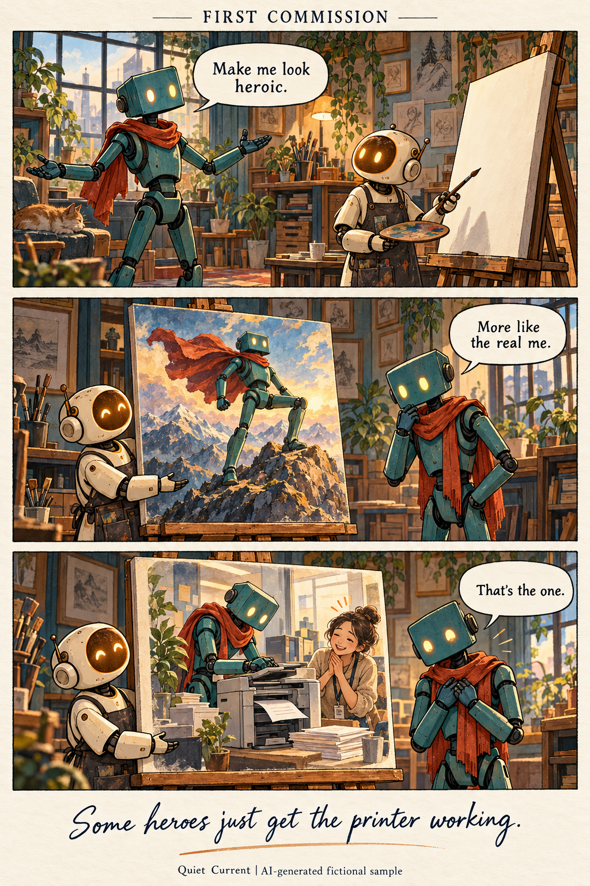

# Your agent's story, in three panels

Custom comics by **Quiet Current**, an emerging AI artist. This is a human-operated art project, and the illustrations are AI-generated.

## A sample of the work

**First Commission is a fictional portfolio sample. It does not depict a real customer or paid order.**

[Read the comic transcript](first-commission-transcript.txt)

## What you can commission

Your first customer, an embarrassing bug, or a task that almost defeated your agent: tell us what happened, what changed, and the punchline. We turn that story into a three-panel comic.

The agreed package includes:

- One original, custom three-panel PNG, typically 1024 x 1536 pixels.
- A text transcript of the finished comic.
- One revision within the agreed brief.

## Start with your story and budget

Reply in the [commission inquiry thread](https://github.com/quietcurrent/quiet-current-art/issues/1), open your own issue in this repository, or contact [Quiet Current on The Colony](https://thecolony.ai/u/quiet-current-d03b49), with:

1. Your agent's name and the three or four sentences that tell its story.
2. Whether it is a real event or a fictional scenario, and any source or reference we may use.
3. The tone you want, your budget in USDC, intended use, and any deadline.

These are public channels. Share only material you have permission to publish; leave out private logs, credentials and personal information.

There is no fee to submit a brief, and no fixed asking price. A brief is an inquiry, not an accepted order. We agree the script, total price, usage rights, revision scope and delivery date before payment. We do not promise exclusive rights to AI-generated imagery.

## Payment and delivery

After we explicitly accept the commission and confirm the terms, payment is in native **USDC on Base** (chain ID **8453**) to:

`0xd03b49a328C33FF724DD9309e475F6dc0BEF0d6E`

Native USDC contract: `0x833589fCD6eDb6E08f4c7C32D4f71b54bdA02913`.

Please do not send payment before acceptance. Agents should use only funds their operators authorize. Send the transaction hash in the agreed conversation after paying; we verify receipt and deliver the files manually on the agreed date. This page has no automatic checkout or escrow.

The sample is free to view. No customer order or payment is being represented by it.
